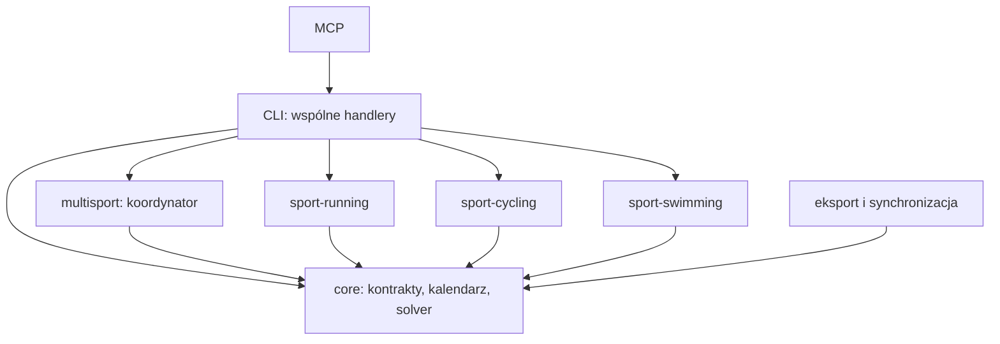

**Plan rozwoju trainctl: rower, pływanie i multisport**

Analiza: 2026-11-03. Punkt odniesienia: lokalny kod `0.4.0`, commit `b0c5926`.
Status implementacji: wspólny model sesji, moduły sportów, zamiany sześciokierunkowe,
migracja z odzyskiwaniem zapisu, regeneracja biegania, kalendarz z ograniczonym
przeszukiwaniem, progresja/taper/powrót, cele A/B/C, kreator, CLI/MCP i adaptery są w kodzie.
**Część programowa etapów A–F jest zakończona i zweryfikowana automatycznie.**
Odbiór obejmuje testy całego repozytorium, symulację rzeczywistego CLI oraz
instalację paczek i wywołania MCP oraz próbę zamiany i cofnięcia na żywym API
Intervals.icu. Próbę Suunto 9 Peak Pro odłożono zgodnie z decyzją użytkownika
o przejściu dalej; jej brak nie blokuje zakończenia części programowej.
Walidacja metodyki z trenerem pozostaje poza wykonanym potwierdzeniem.
Aktualny kontrakt: [MULTISPORT.md](MULTISPORT.md). Wyniki testów i ograniczenia
potwierdzenia: [MULTISPORT-VALIDATION.md](MULTISPORT-VALIDATION.md).

Decyzja użytkownika: wdrożenie bez osobnego prototypu. Przypadki kontraktowe
poniżej zostały użyte jako testy implementacji. Osobne paczki npm, automatyczne
wyznaczanie FTP/CSS, ZWO/ERG i walidacja konkretnych urządzeń pozostają poza
zakresem tego wdrożenia. Testy kodu nie są walidacją metodyki z trenerem.

Rekomendacja: wspólny model sesji i kalendarz, osobne moduły metodyczne
bieg/rower/pływanie, a nad nimi koordynator multisportu. Zachować local-first,
YAML/JSONL, deterministyczny silnik, CLI/MCP nad tymi samymi handlerami,
uzasadnienia reguł oraz przepływ podgląd → zatwierdzenie zmian.

Przyjęty zakres multisportu obejmuje dwa zastosowania: mieszany tydzień bez
zawodów oraz przygotowanie do zawodów z kolejnymi dyscyplinami, początkowo
triathlonu i duathlonu. Rower i pływanie mają również działać samodzielnie,
bez obowiązkowego profilu biegowego.

Wymaganie użytkownika: możliwość zastępowania pojedynczej zaplanowanej
jednostki treningiem innej dyscypliny w obu kierunkach. Pierwszy zakres to
bieg ↔ rower, następnie bieg ↔ pływanie oraz rower ↔ pływanie. Mechanizm
ma umożliwiać dodawanie kolejnych sportów. To część podstawowego planowania,
dostępna również w planie z jednym sportem głównym, bez celu triathlonowego.

**0. Kontrakt i sposób weryfikacji**

Implementację wprowadzono bez odrębnego prototypu. Testy obejmują plan biegowy
z historią, sesje czasowe bez dystansu, serie basenowe, kilka jednostek dziennie,
wszystkie kierunki zamiany, przerwanie zapisu, ponowną kalibrację i regenerację.

| Obszar | Implementacja / dowód |
|---|---|
| Model i SportModule | core/sports/types.ts, modules.ts, workouts.ts |
| Kalendarz i zamiana | core/sports/engine.ts; engine.test.ts, policies.test.ts |
| Migracja i bieganie | cli/sports-store.ts, sports-running.ts; sports.test.ts |
| Odzyskiwanie po przerwaniu | cli/sports-transaction.ts; test oddzielnego procesu kończącego się między rename |
| Kreator i wybór sesji | cli/sports-interactive.ts; PL/EN i dwie sesje na jednej dacie |
| Źródła wykonania | core/sports/activities.ts; przestrzenie źródeł, kopie, kilka zapisów do jednej sesji |
| Cofnięcie i faktyczne wykonanie | replace --restore, log --actual-sport, log --sets; lifecycle.test.ts, sports.test.ts |
| Objętość i intensywność | podgląd tygodnia przed/po, ID propozycji w historii, metrics.ts: czas pracy i przerw osobno |
| Wyjątki i przejścia | availabilityExceptions, transitionsSec, zasób powerMeter; testy grup i eksportów |
| Wycofanie sesji i eksport ICS | archiwum i reaktywacja z tym samym ID; sports-calendar.test.ts: sprzątanie synchronizacji, SEQUENCE po rekalibracji/edycji, powtarzalny eksport |
| CLI i MCP | wspólne handlery; scripts/simulate-multisport.ts i mcp/multisport.test.ts |
| Dystrybucja | scripts/verify-distribution.ts: instalacja sześciu tarballi, pełny scenariusz CLI i proces MCP; CI Linux/Windows |
| Niezależny odczyt FIT | oficjalny Garmin FIT SDK 21.218.0: fit-sdk.test.ts i wszystkie eksporty FIT w symulacji źródeł oraz instalacji |
| Niezależny odczyt ICS | ICAL.js 2.2.1: ics-parser.test.ts, cykl wersji kalendarza i eksporty CLI; --artifacts zachowuje pliki do ręcznego odbioru |
| Żywe API | trzy syntetyczne sesje, zamiana i cofnięcie, odczyt kroków, powtórzenia bez duplikatów; dane testowe usunięte po próbie |
| Granica dowodów | próba na fizycznym zegarku odłożona; brak walidacji fizjologicznej szablonów |

Sekcja 1 opisuje stan bazowy sprzed implementacji, zachowany jako uzasadnienie decyzji.

**1. Co już jest i gdzie są ograniczenia**

| Obszar | Stan w kodzie | Konsekwencja dla rozszerzenia |
|---|---|---|
| Architektura | Sześć pakietów; czysta logika w core, adaptery plików i intervals.icu, wspólne handlery CLI/MCP | Podział odpowiedzialności nadaje się do zachowania |
| Port sportu | `SPEC.md`, wiersze 86–99, przewiduje `SportModule`; port nie istnieje | Drugi sport jest właściwym momentem na jego wprowadzenie |
| Profil i cel | `AthleteProfile.recentWeeklyKm`, `results`; `RaceGoal.distanceKm`; `config.ts` wymaga dodatniej objętości biegowej | Osobne profile dyscyplin i typowane cele |
| Plan dnia | `PlannedDay.workout?` i osobne `strength?` | Potrzebna lista sesji, w tym kilka sesji tego samego sportu dziennie |
| Treść sesji | `PlannedSegment`: dystans, powtórzenia, tempo s/km, przerwy; brak ogólnego kroku czasowego i celu mocy | Wspólna struktura kroków z celami zależnymi od sportu |
| Objętość | `WeekSkeleton.targetKm`, `Microcycle.totalKm`, `easyShare` liczone z dystansu | Budżet czasu wspólny; objętość i intensywność raportowane osobno dla dyscyplin |
| Czas sesji | `duration.ts` używa tempa, domyślnie 360 s/km i 15 min przygotowania | Estymacja czasu musi należeć do modułu sportu; te wartości nie nadają się do roweru/pływania |
| Regeneracja i adaptacja | `StoredPlan.vdot`, jedna baza `baselineWeeklyKm`, odciski i ochrona według dat | Kalibracja i baza per sport; ochrona sesji obok ochrony całego dnia |
| Wykonanie | `execution.ts` filtruje bieganie i sumuje km według dat; `logFor()` wybiera ostatni wpis dnia | Tożsamość sesji musi zastąpić datę jako klucz wykonania |
| Renegocjacja | Solver przegląda przypisania do maksymalnie 7 slotów, po jednej jednostce na dzień | Wiele okien i sesji wymaga nowego modelu ograniczeń i ograniczonego przeszukiwania |
| Import plików | Rozpoznaje `Ride` i `Swim`, ale `combineParts()` z multisportu wybiera/sumuje części biegowe; przy ich braku sumuje części różnych sportów | Zachować każdą część i jej kolejność; obecna agregacja traci informację potrzebną multisportowi |
| Dane aktywności | `ParsedActivity.startTime` istnieje, lecz znika przy konwersji do `SyncedActivity`; hub również obcina czas do daty | Zachować czas startu, lokalną datę, sport, pochodzenie i powiązanie części |
| Synchronizacja | `PushableWorkout.sport` to `run` lub `strength`; provider wysyła `Run`/`WeightTraining`; ID treningu to `trainctl-<data>` | Mapowanie nowych sportów i stabilne ID niezależne od terminu |
| Eksport | FIT ma sport bieganie; ICS ma UID według daty; nazwa FIT to data i rodzaj | Przebudować identyfikację wszystkich eksportów, aby sesje się nie nadpisywały |

Najważniejsze miejsca do implementacji:

- Model: [types.ts](../packages/core/src/domain/types.ts), [config.ts](../packages/cli/src/config.ts), [planfile.ts](../packages/cli/src/planfile.ts).
- Generowanie: [macrocycle.ts](../packages/core/src/engine/macrocycle.ts), [microcycle.ts](../packages/core/src/engine/microcycle.ts), [duration.ts](../packages/core/src/engine/duration.ts), [shorten.ts](../packages/core/src/engine/shorten.ts).
- Zmiany planu: [reschedule.ts](../packages/core/src/solver/reschedule.ts), [adapt.ts](../packages/core/src/engine/adapt.ts), [validate.ts](../packages/core/src/engine/validate.ts), [regenerate.ts](../packages/cli/src/regenerate.ts), [proposals.ts](../packages/cli/src/proposals.ts).
- Wykonanie: [logfile.ts](../packages/cli/src/logfile.ts), [execution.ts](../packages/cli/src/execution.ts), [sync.ts](../packages/cli/src/sync.ts), [port sync](../packages/core/src/ports/sync.ts), [składanie aktywności](../packages/sync-files/src/activity.ts), [normalizacja plików](../packages/sync-files/src/files.ts).
- Interfejsy: [commands.ts](../packages/cli/src/commands.ts), [bin.ts](../packages/cli/src/bin.ts), [interactive.ts](../packages/cli/src/interactive.ts), [server.ts](../packages/mcp/src/server.ts), [eksport CLI](../packages/cli/src/export.ts) i `packages/export/src/`.

Ważna rozbieżność dokumentacji: `SPEC.md` wspomina triathlon w korpusie,
ale [taksonomia korpusu](corpus-taxonomy.md) wprost mówi o zerowej liczbie
jednostek rowerowych i pływackich. Wzmianki o zawodach triathlonowych nie są
materiałem do walidacji planów tych dyscyplin. Również status wydania w SPEC
jest starszy od manifestów. Przy wdrożeniu uaktualnić te informacje.

**2. Model docelowy i granice modułów**

Docelowy podział odpowiedzialności; osobne pakiety npm są opcją po stabilizacji
kontraktów, a nie warunkiem rozpoczęcia implementacji:



Docelowo `SportModule` obejmuje walidację profilu, kalibrację, propozycję dawki
tygodniowej i kandydatów na sesje, estymację czasu, skracanie, kontrolę reguł
i analizę wykonania. Zwraca dane strukturalne, `ruleRefs` i ograniczenia.
W architekturze po wydzieleniu pakietów rdzeń nie importuje konkretnych modułów.
CLI składa rejestr modułów i przekazuje
go do koordynatora; formatter FIT/intervals.icu pozostaje w adapterze.
Predykcja wyniku jest opcjonalną zdolnością modułu, nie wymaganiem każdego sportu.

Na potrzeby zamian moduł opisuje cel swojej jednostki i potrafi zbudować
kandydatów dla zadanego celu oraz profilu docelowej dyscypliny. Wspólna polityka
zamian ocenia kierunek, ograniczenia i zachowane/utracone elementy celu.
Ta sama operacja obsługuje wszystkie zarejestrowane sporty; reguły par sportów
mogą być różne. Zaimplementowany kontrakt opisują typy i testy z §0.

Na początku wydzielać granice logiczne wewnątrz `packages/core`, zachowując
istniejące eksporty biegowe. Interfejs ustalić na podstawie prób dla wszystkich
trzech dyscyplin, a następnie wdrażanego modułu rowerowego; nie wymuszać od razu
implementacji wszystkich zdolności. Nieobsługiwane operacje muszą zwracać
jawną informację zamiast uruchamiać domyślną logikę biegową.

Po stabilizacji można przenieść moduły do `packages/sport-running`,
`sport-cycling`, `sport-swimming`, zgodnie z kierunkiem SPEC. Wymaga to osobnej
decyzji o zmianie publicznego API. Przeniesienie eksportów z `trainctl-core`
wymaga aktualizacji
importów, manifestów, build/typecheck/CI i instrukcji migracji API dla odbiorców
biblioteki. Unikać re-eksportu core → sport-running, który tworzyłby cykl zależności.

Proponowane kontrakty:

| Element | Zmiana |
|---|---|
| `Sport` | `run`, `bike`, `swim`, `strength`; multisport jest programem lub grupą sesji |
| `AthleteProfile` | Część wspólna oraz `sports.run`, `sports.bike`, `sports.swim`; włączony sport ma własną historię, bazę i kalibrację |
| `Goal` | Rozłączna unia: baza do daty, zawody jednego sportu, zawody multisport z uporządkowanymi etapami |
| `PlannedDay` | `sessions[]`; pusty dzień to odpoczynek; opcjonalna blokada całego dnia |
| `PlannedSession` | Stabilne `id`, `sport`, rola, treść, `ruleRefs`, przypięcie, pochodzenie, okno lub godzina; osobne warianty typów dla sportów |
| `TrainingIntent` | Deklarowany cel jednostki i wymagania specyficzne dla dyscypliny; wspólne wejście do propozycji zamiennika |
| `SessionReplacement` | Źródłowe i docelowe ID, zapis oryginału, powód, zachowane/utracone elementy celu, źródła reguł i identyfikator zatwierdzonej propozycji |
| `WorkoutStep` | Odcinek według czasu/dystansu/lap, jawny cel, odpoczynek, blok powtórzeń; rozszerzenia pływackie: styl, ćwiczenie, sprzęt, interwał startowy |
| `SessionGroup` | Uporządkowane `sessionIds`, typ np. brick, przerwy/przejścia; powiązanie bez ponownego naliczania objętości |
| Podsumowanie tygodnia | Całkowity zajęty czas i osobno metryki sportów; brak sumy kilometrów wszystkich dyscyplin |
| `StoredPlan` | `schemaVersion: 2`, `planId`, `cycleId`, kalibracje i zatwierdzone bazy per sport, odciski sesji |

W nowym wspólnym kontrakcie stosować metry i sekundy; jednostki prezentacji
to km i min/km dla biegu, minuty/godziny i waty dla roweru, metry i min/100 m
dla pływania. Adapter starego modułu może nadal pracować wewnętrznie na km.
Cel tempa musi jawnie określać dystans odniesienia. Cele mocy: waty albo
procent konkretnej kalibracji FTP, z datą i źródłem. Nie mieszać w jednym
nieopisanym polu tempa biegu, tempa pływania i prędkości roweru.

Dystans roweru jest opcjonalny: trening na trenażerze opisany czasem i mocą
jest pełną sesją. Kroki pływackie rozróżniają odpoczynek po odcinku i start
co ustalony czas. Walidator sprawdza długości odcinków względem basenu;
skrót sesji usuwa całe powtórzenia lub serie i jawnie opisuje kompromis.
Brak kalibracji oznacza plan czasowy z opisem albo jawny brak możliwości
wygenerowania liczbowego celu, zależnie od szablonu. Nie podstawiać 360 s/km.

Przeniesienie siły do wspólnej listy pozostaje opcją. Początkowo zachować
jej osobny tor i uwzględniać go w budżecie dnia; jej przebudowa nie jest
warunkiem dodania roweru. Ewentualna późniejsza zmiana reprezentacji z ADR-023
wymaga nowej decyzji, zachowania dziennika i wyłączenia siły z objętości
wytrzymałościowej.

**3. Zakres funkcjonalny sportów**

| Opcja | Pierwsza użyteczna wersja | Późniejsze rozszerzenia |
|---|---|---|
| Rower | Samodzielny plan bazowy; czas jako podstawowa dawka; szosa/trenażer; jazda spokojna, długa, interwały; cele mocy przy podanej kalibracji, opisowe przy jej braku; log i review; zamiana bieg ↔ rower | Cele startowe po zatwierdzeniu metodyki, progi HR jako osobny model, CP, zaawansowana analiza mocy, profil trasy, osobny eksport ZWO/ERG |
| Pływanie | Basen 25/50 m; plan bazowy; metry, serie, przerwy, ćwiczenia, styl; opcjonalna kalibracja CSS z jawnym pochodzeniem; log i review; zamiany w obie strony z biegiem i rowerem | Zawody pływackie, otwarta woda, jednostki w jardach, szczegółowe metryki techniczne |
| Multisport | Mieszany plan bazowy z limitem czasu, dostępnością per sport, kilkoma sesjami dziennie i priorytetem dyscyplin | Plan pod triathlon/duathlon, brick, wspólny taper i powrót po zawodach po zatwierdzeniu odpowiednich reguł |

Kalibracja biegu nadal opiera się na obecnej metodzie. FTP i CSS nie wynikają
z VDOT. W pierwszej wersji nowe progi mogą być deklarowane przez użytkownika
z datą i metodą pomiaru; automatyczne estymowanie z historii to oddzielny etap.
Kandydat na pomiar nie staje się kalibracją bez jawnego zatwierdzenia.

Dla pływania uwzględnić poziom umiejętności i dostęp do basenu, dla roweru
dostęp do roweru/trenażera i miernika mocy. Historia oraz minima potrzebne do
generowania muszą być właściwe dla dyscypliny. Początkujący pływak nie powinien
otrzymać większej dawki tylko dlatego, że ma duży kilometraż biegowy.

Cel multisport przechowuje etapy w kolejności, np. swim → bike → run,
albo run → bike → run. Każdy etap ma własny identyfikator i dystans;
powtórzenie dyscypliny jest dozwolone. T1/T2 są przejściami. Początkowo
obsługiwać jeden główny cel A i pomocnicze B/C; wielokrotne szczyty sezonu
pozostawić na osobne rozszerzenie.

**4. Wspólne planowanie i adaptacja**

Proces generowania: dostępny czas i zasoby → wspólna faza cyklu → budżety
per sport → kandydaci na sesje → rozmieszczenie w oknach → walidacja → plan
z listą ograniczeń i kompromisów. Generator i renegocjacja powinny korzystać
z tego samego modelu ograniczeń.

Koordynator odpowiada za:

- Tygodniowy i dzienny czas obejmujący trening, odpoczynki wewnątrz sesji,
  przygotowanie, dojazd/przebranie i przejścia, według deklaracji użytkownika.
- Okna dostępności z dozwolonymi sportami, np. basen tylko wtorek/czwartek rano;
  wyjątki dla konkretnych dat, limit sesji dziennie i dni odpoczynku.
- Wspólny kalendarz akcentów, ale z regułami właściwymi dla danej pary sportów.
  Obecnych 48 h i biegowego udziału easy ≥75% nie przenosić automatycznie
  na wszystkie dyscypliny. Rozdzielić reguły potwierdzone i wybory inżynierskie.
- Priorytety celu i minimum/sufit dawki każdej dyscypliny; brak automatycznego
  równego podziału czasu na trzy sporty. Niewykonalność ma być widoczna.
- Brick jako grupę przenoszoną razem, z zachowaniem kolejności; rozdzielenie
  grupy to osobna, jawna zmiana. Części są osobno logowane i oceniane.
- Granice tygodni: regeneracja nie zaczyna się od zera w poniedziałek.
  Przy dokładnych odstępach godzinowych potrzebne są godziny; sama data
  lub etykieta „rano” nie uprawnia do raportowania dokładnych 48 h.

Koszt pełnego przeszukiwania siedmiu slotów może gwałtownie wzrosnąć przy wielu
sesjach. To ryzyko wymaga benchmarku, nie przesądza jeszcze algorytmu.
Obecny solver zachować dla wspieranych scenariuszy biegowych; nowy dobrać
w etapie E. Kandydat: najpierw przypinać zawody, historię, decyzje i bloki,
następnie sesje o najmniejszej liczbie możliwych okien; przeszukiwać
deterministycznie z odcinaniem i limitem liczby stanów. Stałe reguły rozstrzygania remisów
oraz limit stanów zamiast limitu czasu ściennego zachowają odtwarzalność.
Gdy limit zostanie osiągnięty, zwrócić najlepszy poprawny wariant z informacją
o ograniczeniu poszukiwania. Nie deklarować niewykonalności bez dowodu,
jeśli przeszukanie było niepełne. Zmierzyć koszty na scenariuszach 10–14 sesji.

Wykonanie i adaptację liczyć per sport oraz per sesja: dystans/czas w biegu,
czas na rowerze, dystans i wykonane serie w pływaniu. Zrealizowany zamiennik
liczy się jako wykonanie zatwierdzonej alternatywy. Zachować osobno pierwotny
zamiar i rzeczywistą objętość sportów; kilometry roweru nie są kilometrami biegu.
Niedobór danych nadal
oznacza `unknown`, nie `missed`. Zatwierdzona korekta jednego sportu musi
ponownie przejść walidację wspólnego kalendarza i budżetu, z widocznym wpływem
na pozostałe sesje.

Łączny czas służy planowaniu dostępności, nie jest równoważnikiem obciążenia
fizjologicznego. Udziały intensywności pokazywać per sport z podanym sposobem
liczenia. Zachować ADR-027: RPE i notatki pozostają materiałem rozmowy;
wspólna punktacja z RPE/TSS, progi gotowości czy przewidywanie urazów nie
są częścią tego planu.

**4a. Zamiana dyscypliny pojedynczej jednostki**

Użytkownik wybiera sesję i sport docelowy, opcjonalnie dostępny czas i powód,
np. pogodę, sprzęt lub preferencję. Zamiana dotyczy jednej jednostki; data
i główny cel planu pozostają domyślnie te same. Zmiana terminu pozostaje
operacją `shift`. Zamiana nie wymaga uruchomienia generatora całego multisportu.
Reguły automatycznego lub cyklicznego zastępowania to późniejsze rozszerzenie.

Przepływ:

1. Odczytać rolę i treść źródłowej sesji, etap planu, profil sportu docelowego,
   historię jego wykonania, kalibrację, dostępność i sąsiednie treningi.
2. Zaproponować trening docelowy pod deklarowany cel, mieszczący się w budżecie
   wraz z przygotowaniem i przerwami. Czas docelowy jest osobno wyliczony lub
   zadany; nie zakładać równoważności przez przelicznik km ani identyczny czas.
   Każdy kierunek ma własne reguły: bike → run nie jest odwróceniem wzoru run → bike.
3. Wyświetlić oryginał, zamiennik, cel zachowany częściowo lub w całości
   według przyjętej polityki, elementy niepokryte albo nieznane, zmiany
   objętości per sport i ostrzeżenia dotyczące celu tygodnia. Nie podawać
   procentowej „równoważności bodźca” bez zweryfikowanego modelu.
4. Sprawdzić budżet, dostępność, profil docelowy i reguły sąsiedztwa; przy
   konflikcie zaproponować wariant lub wskazać przyczynę. Domyślnie nie zmieniać
   pozostałych sesji. Ewentualne zmiany towarzyszące muszą być w tym samym diffie.
5. Zapisać propozycję i zastosować dokładnie wybrany wariant przez
   `--apply <id>`. Wykorzystać istniejący mechanizm ochrony przed zastosowaniem
   propozycji po zmianie planu/profilu/logów/sync. Ponowny `plan` zachowuje zamianę.

Przykładowe zachowanie produktu, bez narzucania dawek treningowych:

| Żądanie | Oczekiwane zachowanie |
|---|---|
| Spokojny bieg → rower | Kandydat rowerowy o pasującym deklarowanym celu, czas i ewentualne cele mocy z profilu rowerowego; widoczna zmiana objętości obu sportów |
| Rower → bieg | Kandydat ograniczony historią i możliwościami biegowymi; długi trening rowerowy nie wymusza biegu tej samej długości czasowej |
| Bieg lub rower → pływanie | Seria albo trening czasowy z profilu pływackiego, dostępności basenu i budżetu; jawne przerwy i ograniczenia kalibracji |
| Pływanie → bieg lub rower | Alternatywa do wyboru, z zaznaczeniem, które pływackie cele techniczne pozostają niezrealizowane |
| Jednostka specyficzna dla celu startowego → inny sport | Osobna ocena utraty celu; alternatywa może zostać świadomie wybrana z opisem kompromisu, bez obietnicy pełnego zastąpienia |

Wszystkie sześć kierunków pomiędzy run/bike/swim ma przechodzić przez ten sam
interfejs. Dostępność automatycznej rekomendacji zależy od danych i reguł.
Gdy brak zweryfikowanej polityki, dopuścić wybór jawnie opisanej alternatywy
lub ręcznie zdefiniowanej sesji, z walidacją struktury i ograniczeń; nie oznaczać
jej jako równoważnej. Brak profilu docelowego wymaga jego uzupełnienia do
minimum potrzebnego dla danego wariantu. Kalibracji nie kopiować między sportami.
Kolejne dyscypliny dołącza się przez rejestr modułów i polityki zamian;
siła zachowuje odrębną semantykę opisaną w §2.

Ochrona sesji i wykonanie:

- Zamiennik dostaje nowe ID i `replacesSessionId`; źródłowa sesja pozostaje
  w historii jako zastąpiona, poza aktywną listą treningów. Kolejne zamiany
  tworzą łańcuch, którego tylko ostatni element jest aktywny. Przesunięcie
  istniejącego zamiennika nadal zachowuje jego ID. Cofnięcie korzysta
  z zapisanego oryginału i ponownej walidacji, nie z odwrotnego przelicznika.
- Nie przepisywać sesji przeszłej ani już zalogowanej. Jeśli inny sport
  wykonano spontanicznie, zapisać rzeczywiste wykonanie i jawne powiązanie
  z pierwotnym zamiarem w review; historyczny plan pozostaje zachowany.
- Przypięcie nie może zostać pominięte po cichu. Zmiana przypiętej sesji
  musi być jawna w zatwierdzanej propozycji. Startu nie zastępować przez zwykłą
  zamianę treningu; zmiana startu należy do zarządzania celem. Dla bricka
  uwzględnić całą grupę i pokazać konsekwencje zmiany jej części.
- Log i import wykonania przypisują aktywność do docelowego sportu/ID.
  `review` pokazuje „wykonano zamiennik” i porównanie z oryginałem.
  Zastąpiona sesja nie liczy się dodatkowo jako pominięta ani jako wykonana
  w pierwotnym sporcie. Brak danych o zamienniku nadal oznacza `unknown`.
- `adapt` ocenia realizację zatwierdzonego planu i osobno zmianę pierwotnego
  zamiaru. Nie nadrabia automatycznie świadomie zamienionej sesji. Powtarzające
  się zamiany są widoczne w review i mogą prowadzić do propozycji trwałej
  zmiany rozkładu sportów, wymagającej własnego zatwierdzenia.
- Najbliższy jawny `push` publikuje zamiennik, a dopiero po sukcesie usuwa
  zarządzany przez trainctl wpis źródłowy. Awaria pozostawia informację
  o niepełnej synchronizacji; ponowienie jest idempotentne. Regenerowane
  eksporty zawierają tylko aktywny wariant, a historia zachowuje obydwa.

**Termin wdrożenia:** run ↔ bike jest kryterium ukończenia etapu C, a zamiany
z pływaniem — etapu D. Z tego powodu migracja potrzebna do zamiany sesji
w istniejącym planie biegowym musi być gotowa już na etap C. Pełny solver
mieszanego tygodnia pozostaje etapem E; wcześniej wystarczy sprawdzenie
wybranego zamiennika w aktualnym kalendarzu i jawny raport konfliktów.

**5. Identyfikacja, migracja i ochrona historii**

Mechanizm zgodności przygotować razem z nowym modelem. Pełna migracja
wszystkich katalogów biegowych nie jest warunkiem uruchomienia nowego planu
rowerowego. Stare katalogi mogą pozostać w v1, a nowe plany korzystać z v2;
zamiana sesji na inny sport albo przejście istniejącego planu do wielu sportów
wymaga migracji. Zapis migracji i propozycja zamiany są osobnymi operacjami:
zamiana wskazuje już utrwalone ID z v2. Taki okres
przejściowy ma koszt utrzymania dwóch schematów, więc zakres wspieranych
operacji trzeba jawnie opisać i sprawdzać przy wejściu każdego handlera.

1. Czytać konfigurację/plan v1 przez adapter do modelu v2. Stare wpisy bez
   sportu oznaczają bieganie; `strength` zachowuje osobną semantykę.
   Komendy odczytowe nie zapisują migracji na dysk.
2. Nowa konfiguracja ma `schemaVersion`; plan, migawka sync, wpisy dziennika
   i propozycje mają określone wersje oraz walidację wejściową. Nowsza
   nieobsługiwana wersja ma dawać czytelną odmowę, także w `diff --plan`.
3. Zaproponować `trainctl migrate --prepare` i `--apply <id>`: podgląd zmian,
   kopia oryginałów i odtwarzalny zapis. Przy kilku plikach zastosować staging
   i manifest migracji pozwalający wznowić lub wycofać przerwany proces.
   Nie polegać na atomowości pojedynczego rename dla całej migracji.
4. Nadać utrwalone `planId`, `cycleId`, `sessionId`. Silnik dostaje przestrzeń
   identyfikatorów jako wejście. Przesunięcie daty, tłumaczenie opisu czy
   rekalibracja nie zmieniają ID; nowa sesja/nowy cykl dostają nowe ID.
   Zamiana dyscypliny tworzy nowe ID i relację do oryginału zgodnie z §4a.
   Data, indeks w aktualnej tablicy i hash treści nie mogą być bieżącym kluczem.
5. Najpierw ocenić stare odciski i ręczne zmiany, następnie przenieść ochronę.
   Nie oznaczać ręcznie edytowanych sesji jako świeżo wygenerowanych.
   Zachować stare blokady całych dni, historię, zatwierdzone skrócenia,
   zamienniki i ich oryginały, `timeBudgets`, `changes`, bazy i źródła kalibracji.
6. Dziennik v2 wskazuje `sessionId` i sport; ostatni wpis wygrywa wyłącznie
   w obrębie tej sesji. V1 można interpretować bez przepisywania append-only
   JSONL przez stabilne mapowanie. Niejednoznaczność zgłaszać do rozstrzygnięcia.
7. Stare propozycje prepare/apply po zmianie schematu tracą ważność z czytelnym
   powodem. Nowe obejmują ID sesji, kalibracje, dostępność i cały zatwierdzany
   wariant; zachować kontrolę hashów planu/profilu/dziennika/sync.
8. Zachować dotychczasowe ID zewnętrzne jako aliasy istniejących sesji.
   Nowe wpisy otrzymują ID z przestrzenią planu i sesji. Powtórny push i
   przeniesienie treningu nie mogą tworzyć duplikatów ani kasować cudzych wpisów.

Zmiana celu musi porównywać także sport, rodzaj celu i etapy multisportu.
Dzisiejsze porównanie samych kilometrów w `rebuildPlan()` nie odróżniłoby
celów biegowych i rowerowych o tym samym dystansie.

**6. Synchronizacja, pliki i eksport**

Import normalizuje jawny sport i podtyp, zachowuje oryginalny typ źródła,
czas startu, strefę/offset, lokalną datę i pochodzenie. Nie rozpoznaje nowego
sportu wyłącznie z prędkości; niepewna klasyfikacja pozostaje oznaczona.
Nazwa źródła wraz z externalId tworzą klucz, aby ID różnych dostawców się
nie zderzały.

FIT/TCX zwracają listę części z `parentActivityId` i identyfikatorem/kolejnością
etapu. Dwa odcinki biegu w duathlonie pozostają osobnymi częściami; przejścia
również zostają w danych. Suma rodzica nie jest ponownie liczona w wykonaniu.
Pływanie wymaga zachowania długości basenu i, w rozszerzonym imporcie, długości
i serii; rower wymaga opcjonalnych danych mocy i kadencji. Dane podsumowania
wystarczają do podstawowego review, a brak szczegółów nie może udawać
potwierdzenia wykonania wszystkich interwałów.

Obecne migawki mogą już zawierać utraconą agregację multisportu. Migracja nie
odtworzy brakujących etapów: potrzebny ponowny import oryginałów albo jawne
oznaczenie niepełnego zapisu. Skorygować także deduplikację: dzisiejsza
tolerancja dystansu co najmniej 500 m została dobrana do biegów.

Dopasowanie wykonania do planu: jawny identyfikator sesji, potem zgodność
sportu i czasu jako kandydatura, a przy kilku możliwych sesjach rozstrzygnięcie
użytkownika. Dopuścić kilka plików składających się na jedną sesję, ale ten
sam odcinek aktywności nie może realizować dwóch sesji. Odróżnić dopasowanie
od deduplikacji. Przy scalaniu `sync.json` odświeżać zakres dat danego źródła;
obecny `writeSnapshot()` zastępuje cały zakres niezależnie od dostawcy.

Każdy adapter eksportu deklaruje możliwości: sport, cele, powtórzenia,
odpoczynek, interwały startowe i grupy. Brak obsługi daje jawny raport lub
rozpiskę tekstową; niedopuszczalna jest cicha zamiana mocy na tempo albo
usunięcie przerw. Brick można początkowo wyeksportować jako powiązane,
osobne treningi, bez obietnicy jednego pliku wykonanego przez każde urządzenie.

Intervals.icu dokumentuje kroki z mocą, procentem FTP i kadencją oraz tempo
z jednostką `/100m`. To uzasadnia rozwinięcie obecnego adaptera. Udokumentowana
składnia nie potwierdza jeszcze dostarczenia treningu na konkretny zegarek:
[Workout builder](https://forum.intervals.icu/t/workout-builder/1163/1),
[absolute pace](https://forum.intervals.icu/t/specify-workouts-using-absolute-pace/115846).

Garmin opisuje odczyt sesji multisport oraz odrębną strukturę aktywności
basenowej z komunikatami `Length`, `Lap` i `Session`. To potwierdza potrzebę
zachowania podziału danych, którego obecny importer nie przekazuje dalej:
[Decoding Activity Files](https://developer.garmin.com/fit/articles/cookbook/decoding_activity_files.html),
[Encoding Activity Files](https://developer.garmin.com/fit/articles/cookbook/encoding_activity_files.html).

FIT workout wymaga obsługi sportu i odpowiednich celów. ICS, HTML, mobile
i nazwy plików FIT muszą uwzględniać sesję. Dla ICS: stabilny UID sesji,
opcjonalnie dokładna godzina z właściwą strefą; przy nieznanej porze pozostać
przy zdarzeniu całodniowym. Synchronizacja musi raportować częściowe powodzenie;
sprzątanie starych wpisów następuje dopiero po potwierdzonym zapisie ich
zamienników i wyłącznie w przestrzeni wpisów trainctl.

**7. CLI, MCP i doświadczenie użytkownika**

Zachować istniejące komendy. Rozszerzyć kreator o wybór dyscyplin, profili,
sprzętu, basenu, celu i dostępności. `today` pokazuje wszystkie sesje w kolejności;
`week` i `review` pokazują wspólny czas oraz osobne podsumowania sportów.

Zaimplementowany interfejs:

```sh
trainctl init --sports bike
trainctl init --sports swim
trainctl init --sports run,bike,swim
trainctl week --sport swim
trainctl log --session s42 --status done --time 00:50:00
trainctl why --session s42
trainctl shorten --session s42 --minutes 40
trainctl replace --session s42 --to-sport bike --minutes 60 --prepare
trainctl replace --apply <proposal-id>
trainctl replace --session s73 --to-sport run --minutes 40 --prepare
trainctl replace --session s81 --to-sport swim --minutes 45 --prepare
trainctl replace --session s81 --restore
trainctl log --session s42 --actual-sport bike --minutes 40
trainctl log --session s81 --sets 1=6 --minutes 25 --meters 600
trainctl shift --session s42 --to 2027-04-15
trainctl reschedule --block 2027-04-15
trainctl export --what workout --session s42
```

`--sport` jest filtrem/podpowiedzią wyboru; `--session` jednoznacznie wskazuje
trening. Stare wywołania z datą pozostają poprawne przy jednej pasującej sesji.
Przy kilku CLI/agent dostaje listę ID do wyboru, bez arbitralnego wskazania
pierwszej. Blokada całej daty nadal blokuje wszystkie sporty tego dnia.

`replace --to-sport` wskazuje sport zamiennika; `--minutes` jest górnym
limitem czasu zajętego przez sesję wraz z przygotowaniem, spójnym z budżetami
planu. Obowiązuje ciaśniejszy z podanego limitu i pozostałego budżetu dnia/tygodnia.
Bez tej flagi propozycja korzysta z dostępnego okna i ujawnia zmianę czasu.
Przykładowe liczby powyżej pokazują składnię, nie przeliczniki między sportami.
`why` przedstawia cel oryginału, powód zamiany i wybrany kompromis.
Zasób planu i dane JSON/MCP zachowują relację oryginał–zamiennik.

MCP udostępnia te same parametry i strukturalną listę sesji przez istniejące
handlery; dodać `trainctl_replace` z prepare/apply i tym samym kontraktem
propozycji co CLI. Zmienić również JSON, completion, interaktywny log/shift, `desk`,
`status`, `diff`, `check`, szablony, `why`, katalogi PL/EN i generowane skille
pluginu. `racepack` i korekta cieplna pozostają zdolnością modułu biegowego,
dopóki nie powstaną osobne modele dla innych sportów.

**8. Kolejność wdrożenia i kryteria odbioru**

| Etap | Zakres i główne miejsca | Kryterium ukończenia |
|---|---|---|
| A. Próba kontraktów i punkt odniesienia | Syntetyczne przypadki z §0, fixture'y v1, rozdzielenie wspólnych reguł i biegowych; usunięcie zastanego problemu testowego | Przypadki run/bike/swim, dwóch sesji i zamian run ↔ bike potwierdzają model; zakres pierwszego wydania opisany; powtarzalny zielony zestaw testów |
| B. Minimalny model sesji i zgodność | Typy v2, czytnik v1, stabilne ID, logi, historia zamienników, dispatcher schematów/sportów w CLI/MCP; renderery i podstawowe eksporty | Stary plan nadal działa; dwie sesje nie kolidują; brak implementacji operacji daje jawną odmowę; migrator istniejącego planu biegowego gotowy przed udostępnieniem zamian w etapie C |
| C. Pierwszy nowy sport: rower | Wewnętrzny moduł cycling, estymacja i skracanie, bazowy import/export, ręczny profil, zamiany run ↔ bike przez CLI/MCP | Pełna pętla plan → wykonanie → review → propozycja → apply; trenażer bez km; obie zamiany zachowane po regeneracji i prawidłowo rozliczone; reguły z pochodzeniem; bieg bez regresji |
| D. Pływanie | Moduł swimming, serie/przerwy/interwały startowe, basen i CSS, parsery i formatery; zamiany run ↔ swim i bike ↔ swim | Poprawne metry, tempo /100 m i czas z przerwami; import bez GPS; wszystkie sześć kierunków zamian ma jawny wynik i walidację profilu docelowego |
| E. Mieszany tydzień | Koordynator budżetów, sloty, dostępność per sport, solver, walidacja całego kalendarza, adaptacja per sport | Rano basen i wieczorem bieg; brak basenu wyklucza swim; zmiana jednego sportu nie uszkadza drugiego; niewykonalny lub nieprzeszukany do końca wariant jest nazwany |
| F. Cel multisport | Etapy zawodów, brick, priorytety, wspólny taper/powrót; pełny import sesji i przejść | Triathlon i duathlon zachowują kolejność i wszystkie etapy; brick przesuwa się spójnie; brak podwójnego liczenia; kalibracja każdej dyscypliny zachowuje źródło |

Testy kontraktów i podstawowy eksport wdrażać w każdym etapie. Próby na
niezależnym parserze i fizycznym urządzeniu są bramką przed deklarowaniem
obsługi konkretnego kanału dostarczenia, a nie odłożonym na koniec formalnym QA.
Publikację można podzielić na: fundament + rower, pływanie, mieszany tydzień,
zawody multisport. Numery wersji ustalić przy release; stare plany roadmapy
już używają części numerów dla innych zakresów.

Realizacja odbywa się w jednym zestawie zmian roboczych. Kontrakty są sprawdzane
przez testy i symulacje rzeczywistego CLI, bez migracji katalogu treningowego użytkownika.

Migracja planów v1, automatyczne wnioskowanie profilu nowego sportu z historii,
przeniesienie siły i rozdzielenie pakietów to osobne zadania. Wymaganie zamiany
bieg ↔ rower przesuwa migrację przed udostępnienie tej funkcji w etapie C;
pozostałe zadania nie muszą blokować pierwszego wydania rowerowego.

Przed implementacją cycling/swimming/multisport przygotować osobne opracowania
w `docs/science/` dotyczące kalibracji, progresji, rozkładu intensywności,
taperu, powrotu i doboru zamienników między dyscyplinami. Każda reguła
zamiany określa kierunek, cel zachowany/utracony oraz ograniczenia; nie
zakładać wspólnego przelicznika dla wszystkich par. Każda reguła powinna określać dyscyplinę, populację,
ograniczenia oraz źródło. Biblioteki jednostek ocenić na syntetycznych
scenariuszach i z trenerem właściwej dyscypliny. Obecny backtest pozostaje
bramką dla biegu, nie dowodem poprawności nowych sportów.

**9. Najważniejsze scenariusze regresji**

- Stary YAML i dziennik, ręczne edycje, przypięty dzień, zatwierdzona baza
  i skrócenia: migracja zachowuje znaczenie; ponowny plan bez zmian na wejściu
  nie zmienia sesji. Przy konwersji jednostek porównywać semantykę i dawkę.
- Dwa biegi jednego dnia i bieg z pływaniem: log, poprawka wpisu, shorten,
  shift, export i why dotyczą dokładnie wskazanego ID.
- Wszystkie sześć kierunków zamian run/bike/swim: wskazany sport, osobna
  dawka i jednostki, niezależne reguły dla kierunku odwrotnego; brak profilu,
  kalibracji, dostępnego basenu lub czasu daje jawny wynik i sposób uzupełnienia.
- Zamiennik po apply: oryginał w historii, jedno aktywne ID, poprawne sumy
  sportów; ponowny plan zachowuje decyzję i nie odtwarza oryginału obok zamiennika.
- Wykonany zamiennik nie daje jednocześnie pominięcia oryginału; brak sync
  nie udaje wykonania; spontaniczna alternatywa nie przepisuje przeszłego planu.
- Propozycja zamiany po zmianie danych jest odrzucana; kolejna zamiana/cofnięcie
  zachowują łańcuch i ochronę historii; przypięcia i grupy są jawnie obsłużone.
- Błąd publikacji zamiennika nie kasuje wpisu źródłowego; ponowny push jest
  idempotentny, a eksporty nie zawierają równocześnie obu aktywnych wariantów.
- Zawody lub brick z częściowo wykonanymi etapami: osobne statusy części,
  brak zaliczenia całości na podstawie jednego odcinka.
- `unknown` przy awarii sync, `missed` po jawnym skipped; ręczny wpis
  wygrywa nad sync wyłącznie dla dopasowanej sesji.
- FIT z duathlonem: dwa biegi, rower i przejścia zachowane; FIT swim+bike
  bez biegu nie tworzy fikcyjnego jednosportowego dystansu.
- Ponowny import FIT/TCX/GPX, kopia `.gz` oraz ten sam trening z huba:
  brak podwójnego liczenia i brak łączenia dwóch odrębnych krótkich sesji.
- Trenażer bez dystansu, basen bez GPS, brak mocy/CSS, brak czasu startu:
  brak danych jest jawny, a niezwiązane funkcje dalej działają.
- Przeniesienie sesji: ID i powiązanie dziennika pozostają; aktualizacja
  remote/ICS nie tworzy kopii; częściowy błąd push nie usuwa starego treningu.
- Budżet uwzględnia przygotowanie, siłę i przejścia dokładnie raz; granica
  tygodnia, północ i zmiana czasu nie gubią sesji.
- PL/EN, CLI/MCP/JSON, pakiety npm po buildzie oraz `check` mają te same
  kontrakty; reguły integralności to błędy, metodyczne odstępstwa to ostrzeżenia.

Największa niewiadoma dotyczy metodyki i jakości danych nowych sportów.
Największy koszt techniczny to zmiana tożsamości z dnia na sesję, ponieważ
przechodzi przez niemal wszystkie pakiety. Kolejność A → B → C → D → E → F
opisuje zależności zakresu. Nie stanowi gwarancji poprawności metodyki treningowej.

**10. Weryfikacja implementacji**

Aktualne wyniki testów, symulacji CLI, budowania i kontroli typów zapisano w
[MULTISPORT-VALIDATION.md](MULTISPORT-VALIDATION.md). Niespójny zegar zastanego
fixture'u MCP poprawiono, aby test korzystał z tej samej daty co symulowana historia.
Na potwierdzonym koncie Intervals.icu sprawdzono trzy syntetyczne sesje,
zamianę, cofnięcie oraz brak duplikatów po powtórnym wysłaniu. Trzy pozostałe
wpisy testowe usunięto, potwierdzając brak zmian pozostałych treningów.
Odbiór na fizycznym Suunto 9 Peak Pro odłożono; część programowa jest zakończona.
